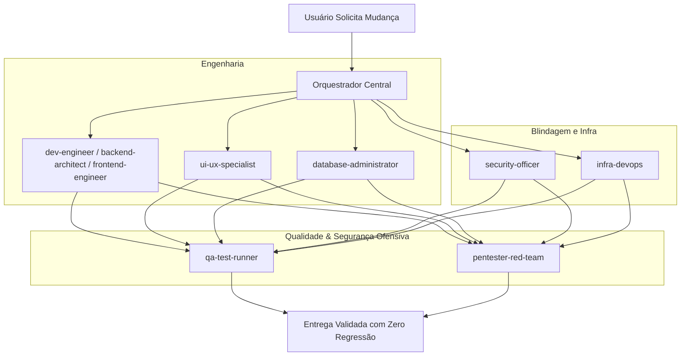

# Multi-Agent Architecture & Project Guidelines - Argos

Este documento define o ecossistema completo de agentes especializados, suas responsabilidades, padrões de engenharia e fluxos de cooperação para evolução contínua do projeto.

---

## 🤖 Catálogo Completo de Agentes Especializados

| Agente | Disciplina | Escopo Principal | Tecnologias & Ferramentas |
| :--- | :--- | :--- | :--- |
| **`dev-engineer`** | **DEV** | Engenharia Fullstack, Arquitetura Limpa & Padrões | FastAPI, Angular 19, Pydantic v2, SOLID, TypeScript. |
| **`backend-architect`** | **DEV (BE)** | API, Pipeline Assíncrono, DB & Background Jobs | FastAPI, AnyIO, Asyncio Lifespan, CORS, REST. |
| **`frontend-engineer`** | **DEV (FE)** | Interface Web, Gráficos & Reatividade | Angular 19 Standalone, Chart.js 4, Signals, RxJS, SCSS. |
| **`social-intelligence-expert`** | **SOCIAL & IA**| Social Listening Multi-Rede, Bypassing & IA | Scrapetube, curl_cffi (TLS Impersonation), Gemini, Groq. |
| **`security-officer`** | **SECURITY** | AppSec Defensivo, OWASP Top 10 & Gestão de Chaves | Mascaramento de tokens, CSP headers, sanitização XSS/SSRF. |
| **`pentester-red-team`** | **PENTESTER** | Segurança Ofensiva, Fuzzing & Red Team | Testes de injeção, fuzzing de payloads, IDOR, abusos de cota. |
| **`ui-ux-specialist`** | **UI & UX** | Design System Argos Dark, Heurísticas & A11y | Dark Theme (#0f172a/#1e293b), WCAG 2.1 AA, Nielsen, Chart.js UX. |
| **`database-administrator`** | **DBA** | Modelagem Relacional/JSONB, Índices & Tuning | PostgreSQL 16, SQLite WAL, asyncpg pool, índices B-Tree/GIN. |
| **`infra-devops`** | **INFRA** | Containers, Docker Compose, Nginx & Deploy | Docker Compose, Nginx Alpine, Multi-stage builds, Healthchecks. |
| **`qa-test-runner`** | **QA** | Testes Automatizados, Blindagem & CI | pytest, pytest-asyncio, HTTPX TestClient, npm run build. |

---

## 🏛️ Papéis e Responsabilidades Detalhadas

### 1. `dev-engineer` (Fullstack & Software Engineering)
- **Foco:** Entregar funcionalidades completas da rota ao componente mantendo arquitetura limpa e sem acoplamento.
- **Regras:** Tipagem estrita (Python 3.12 e TypeScript), desacoplamento de camadas e zero duplicação de regras de negócio.

### 2. `security-officer` (Defensive AppSec)
- **Foco:** Blindagem da aplicação contra invasões, vazamento de credenciais e conformidade OWASP.
- **Regras:** Nenhum token confidencial exposto em logs ou respostas públicas da API. Sanitização automática de inputs externos.

### 3. `ui-ux-specialist` (Design System & Usabilidade)
- **Foco:** Experiência de uso fluida, moderna, de alto impacto visual e acessível.
- **Regras:** Manter paleta Argos Dark (#0f172a, #1e293b, gradientes), feedback visual para todas as ações e respeito às 10 Heurísticas de Nielsen.

### 4. `pentester-red-team` (Offensive Security)
- **Foco:** Identificar ativamente falhas antes que cheguem à produção.
- **Regras:** Fuzzing em parâmetros de query, auditoria de SSRF em coletores externos e verificação de integridade de IDs de jobs (/api/jobs/{job_id}).

### 5. `database-administrator` (DBA)
- **Foco:** Alta performance em queries, integridade e resiliência de dados.
- **Regras:** Índices obrigatórios em chaves de busca (`username`, `query`, `created_at`). Connection pool seguro (`asyncpg`) e manutenção da paridade Postgres/SQLite.

### 6. `infra-devops` (Infraestrutura & Containers)
- **Foco:** Orquestração previsível, imagens leves e ambiente reproduzível em 1 comando.
- **Regras:** Orquestração estrita com `docker compose up -d --build`, healthchecks em todos os serviços e Nginx com proxy reverso e gzip ativado.

---

## ⚡ Fluxo de Colaboração Dinâmica

---

## 🛠️ Comandos Rápidos de Execução

- **Validação de Qualidade Completa (1 Comando):** `powershell -File .\scripts\run_tests.ps1`
- **Subir Servidores de Desenvolvimento:** `powershell -File .\scripts\start_dev.ps1 -Service all`
- **Subir Stack Completa via Docker:** `docker compose up -d --build`
- **Executar Testes Backend:** `python -m pytest backend/tests -v`
- **Compilar Frontend:** `npm --prefix frontend run build`
