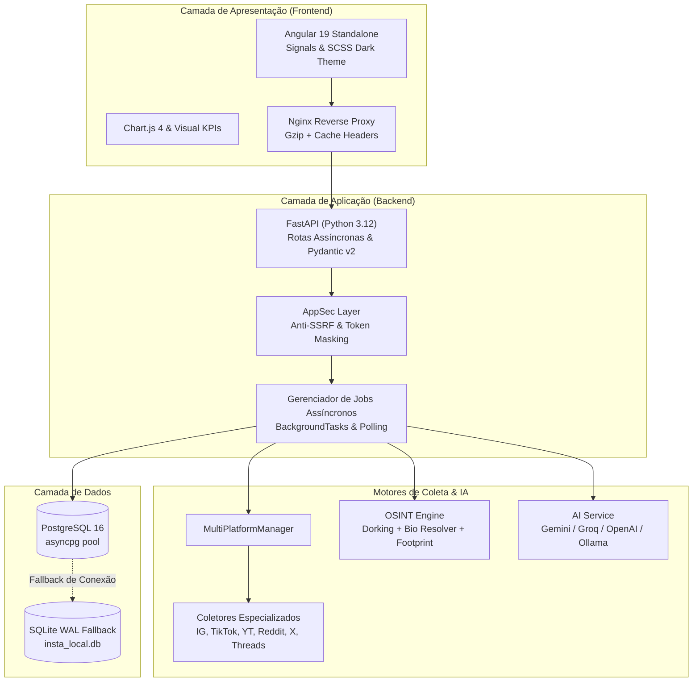

# 🌐 Argos Social — Instagram Analytics Pro & Transmedia Intelligence Suite

<p align="center">
  
  
  
  
  
  
  
  
</p>

---

> **Plataforma Enterprise de Social Listening Multi-Rede, Inteligência OSINT e Consultoria Estratégica com Inteligência Artificial.**  
> Projetada para criadores de conteúdo, agências e analistas de inteligência de mercado que necessitam de auditoria unificada em **Instagram, TikTok, YouTube, Reddit, X (Twitter) e Threads**.

---

## 📌 Índice

- [Destaques do Projeto](#-destaques-do-projeto)
- [Arquitetura do Sistema](#-arquitetura-do-sistema)
- [Funcionalidades Principais](#-funcionalidades-principais)
  - [1. Social Listening Multi-Rede 360°](#1-social-listening-multi-rede-360)
  - [2. Módulo de Investigação OSINT & Pegada Digital](#2-módulo-de-investigação-osint--pegada-digital)
  - [3. Analytics Profundo de Instagram](#3-analytics-profundo-de-instagram)
  - [4. Auditoria & Consultoria Estratégica com IA](#4-auditoria--consultoria-estratégica-com-ia)
  - [5. Centro de Exportação Corporativa](#5-centro-de-exportação-corporativa)
- [Stack Tecnológica](#-stack-tecnológica)
- [Início Rápido (Quick Start)](#-início-rápido-quick-start)
  - [Opção 1: Via Docker Compose (Recomendado)](#opção-1-via-docker-compose-recomendado)
  - [Opção 2: Desenvolvimento Local Nativo](#opção-2-desenvolvimento-local-nativo)
- [Configuração de Ambiente (.env)](#-configuração-de-ambiente-env)
- [Estrutura do Repositório](#-estrutura-do-repositório)
- [Qualidade & Testes Automatizados](#-qualidade--testes-automatizados)
- [Segurança & Resiliência (AppSec)](#-segurança--resiliência-appsec)
- [Arquitetura Multiagente](#-arquitetura-multiagente)

---

## ⚡ Destaques do Projeto

* 🔄 **Social Listening Omnichannel Unificado:** Monitore termos, concorrentes, marcas e criadores em 6 plataformas simultâneas.
* 🕵️ **Motor OSINT & Dorking Automatizado:** Dossiê instantâneo de reputação, mídia kits em PDF, matérias de imprensa e varredura de usernames em 20+ redes.
* 🛡️ **Coleta Resiliente & Anti-Bloqueio:** Bypassing com impersonação de TLS Chrome (`curl_cffi`), scrapers assíncronos open-source e fallback transparente para Atores Apify.
* 🧠 **IA Estratégica Omnichannel:** Diagnóstico 360°, Health Score (0-100), matriz SWOT, ganchos virais de 3s para Reels/Shorts/TikTok e Chat Consultor Interativo (Gemini, Groq, OpenAI ou Ollama).
* 📈 **Dashboard em Angular 19 Standalone:** Interface responsiva com Design System Instagram Dark (`#0f172a` / `#1e293b`), reatividade com Signals e gráficos interativos com Chart.js 4.
* 🗄️ **Persistência Híbrida & Alta Disponibilidade:** PostgreSQL 16 relacional com `asyncpg` e fallback automático para SQLite WAL local.

---

## 🏛️ Arquitetura do Sistema



---

## 🚀 Funcionalidades Principais

### 1. Social Listening Multi-Rede 360°
* **Plataformas Nativas:** Instagram, TikTok, YouTube, Reddit, X/Twitter e Threads.
* **Modos de Operação Duplos:**
  * **Social Listening por Tópico/Hashtag:** Rastreia o volume de menções, sentimento coletivo e ressonância de pautas em tempo real.
  * **Análise de Criador Transmídia:** Investiga a presença de uma figura pública ou marca em todas as redes ao mesmo tempo.
* **Métricas Normalizadas:** Comparações justas de engajamento entre vídeos do TikTok, threads do Reddit, Reels e shorts do YouTube.

### 2. Módulo de Investigação OSINT & Pegada Digital
* **Varredura de Username (Footprint Scanner):** Testa automaticamente o `@username` em 20+ plataformas web (GitHub, YouTube, Twitch, Medium, Spotify, Pinterest, Behance, etc.).
* **Bio Link Resolver:** Analisa páginas de destino (Linktree, Beacons, Carrd, Bento.me) e extrai automaticamente canais oficiais, e-mails de contato e links comerciais.
* **Dorking Web Inteligente (DDGS):**
  * *Preset Reputação:* Pesquisa queixas, ReclameAqui, processos e controvérsias.
  * *Preset Mídia Kit:* Localiza apresentações comerciais, tabelas de preços e PDFs de audiência.
  * *Preset Imprensa:* Varre entrevistas em podcasts, notícias e portais de mídia.
  * *Preset Transmídia:* Mapeia perfis em redes adjacentes.
* **Dossiê Consolidado:** Geração de relatório investigativo unificado em um clique.

### 3. Analytics Profundo de Instagram
* **Métricas Principais:** Taxa de engajamento real (%), média e mediana de curtidas, proporção de comentários e interações totais.
* **Engajamento & Formatos:** Comparativo de desempenho entre Reels, Carrosséis e Imagens estáticas com correlação entre tamanho de legenda e conversão.
* **Hashtags & Menções:** Top 15 hashtags por volume e média de engajamento, detecção de perfis marcados e menções no texto.
* **Timing & Melhores Horários:** Mapa de calor (Heatmap) com distribuição de pico de interações por hora do dia (0h às 23h) e por dia da semana.
* **Sentimento Léxico & Emojis:** Análise léxica de comentários (positivo, neutro, negativo), nuvem de palavras e ranking de comentaristas mais assíduos.
* **Análise de Audiência:** Identificação de usuários que não te seguem de volta, seguidores mútuos com pesquisa e dados demográficos (quando integrado à Meta Graph API).

### 4. Auditoria & Consultoria Estratégica com IA
* **Health Score & Omnichannel Score (0 a 100):** Pontuação executiva baseada em consistência, engajamento e diversificação transmídia.
* **Matriz SWOT Dinâmica:** Forças, Fraquezas, Oportunidades e Ameaças geradas sob medida para o perfil analisado.
* **Fábrica de Roteiros & Ganchos Virais:** Sugestão de 5 roteiros prontos para gravação com ganchos de 3 segundos (3s Hooks) e Chamadas para Ação (CTAs) de alta conversão.
* **Chat Consultor Interativo ("Pergunte à IA"):** Assistente inteligente contextualizado com todas as métricas coletadas para responder dúvidas de estratégia e branding.

### 5. Centro de Exportação Corporativa
* **Planilhas CSV Formatadas:** Exportação com `UTF-8 BOM` (compatibilidade nativa e sem quebra de acentuação no Microsoft Excel) para Posts, Comentários, Hashtags e Audiência.
* **JSON Estruturado:** Backup completo de dados em formato canônico para integrações com pipelines de dados ou BI.
* **Relatório Executivo TXT:** Sumário executivo pré-formatado pronto para apresentações e relatórios de clientes.

---

## 💻 Stack Tecnológica

| Camada | Tecnologia | Papel no Sistema |
| :--- | :--- | :--- |
| **Frontend** | Angular 19 (Standalone) | SPA moderna sem `NgModules`, reatividade com Signals e TypeScript estrito. |
| **UI & Visualização** | SCSS + Chart.js 4 | Design System Instagram Dark (`#0f172a`), responsividade e gráficos interativos. |
| **Backend** | FastAPI (Python 3.12) | API assíncrona de alta performance, Pydantic v2 e lifespan assíncrono. |
| **Scraping & Bypass** | `curl_cffi` + `scrapetube` | Impersonação TLS de fingerprints Chrome e extração rápida multi-plataforma. |
| **Serviços de IA** | Gemini / Groq / OpenAI | Motores de inferência para auditorias SWOT, roteiros e consultoria estratégica. |
| **Bancos de Dados** | PostgreSQL 16 & SQLite | PostgreSQL com `asyncpg` para produção e SQLite WAL para uso local isolado. |
| **Infraestrutura** | Docker Compose + Nginx | Orquestração com healthchecks integrados e proxy reverso Nginx Alpine. |
| **Qualidade & QA** | pytest + HTTPX TestClient | Suíte com 57+ testes automatizados cobrindo rotas, coletores e segurança. |

---

## ⚡ Início Rápido (Quick Start)

### Opção 1: Via Docker Compose (Recomendado)

O ambiente completo (PostgreSQL, Backend FastAPI, Frontend Angular e Nginx) sobe com um único comando:

```bash
# 1. Clone o repositório
git clone https://github.com/SEU_USUARIO/NOME_DO_REPO.git
cd NOME_DO_REPO

# 2. Crie seu arquivo de ambiente a partir do modelo
copy .env.example .env

# 3. Construa e inicialize os containers
docker compose up -d --build
```

**Portas Disponíveis:**
* 🌐 **Aplicação Web (Frontend):** `http://localhost:4200`
* 📖 **Documentação Swagger (Backend):** `http://localhost:8000/docs`
* 🗄️ **PostgreSQL:** `localhost:5432`

Para encerrar os serviços:
```bash
docker compose down
```

---

### Opção 2: Desenvolvimento Local Nativo

Caso queira executar os servidores localmente para desenvolvimento:

#### 1. Pré-requisitos
* Python 3.12+ instalado
* Node.js 20+ e npm instalados

#### 2. Execução Rápida via Scripts PowerShell
O projeto inclui scripts utilitários prontos na pasta `scripts/`:

```powershell
# Iniciar ambos os servidores de desenvolvimento:
powershell -File .\scripts\start_dev.ps1 -Service all

# Executar a suíte completa de testes e validação de build:
powershell -File .\scripts\run_tests.ps1
```

#### 3. Execução Manual

**Backend:**
```bash
cd backend
python -m venv .venv
.\.venv\Scripts\activate  # No Linux/Mac: source .venv/bin/activate
pip install -r requirements.txt
uvicorn main:app --reload --port 8000
```

**Frontend:**
```bash
cd frontend
npm install
npm start
```
Acesse `http://localhost:4200` (o proxy redireciona chamadas `/api/*` automaticamente para a porta 8000).

---

## ⚙️ Configuração de Ambiente (`.env`)

Copie o arquivo `.env.example` para `.env` e configure suas variáveis conforme a necessidade:

| Variável | Obrigatória? | Descrição |
| :--- | :---: | :--- |
| `APIFY_TOKEN` | Opcional | Token da Apify para scraping em escala (se não fornecido na interface). |
| `GEMINI_API_KEY` | Opcional | Chave da Google AI Studio para ativar os diagnósticos de IA com Gemini. |
| `OPENAI_API_KEY` | Opcional | Chave da OpenAI para utilizar modelos GPT. |
| `AI_PROVIDER` | Opcional | Provedor de IA desejado (`gemini`, `openai`, `groq` ou `ollama`). |
| `POSTGRES_USER` | Recomendado | Usuário do banco PostgreSQL (padrão: `insta_user`). |
| `POSTGRES_PASSWORD` | Recomendado | Senha do banco PostgreSQL (padrão: `insta_pass_2026`). |
| `POSTGRES_DB` | Recomendado | Nome da base de dados (padrão: `insta_db`). |
| `DATABASE_URL` | Opcional | String de conexão SQLAlchemy/asyncpg (gerada automaticamente pelo compose). |

> 🔒 **Nota de Segurança:** O arquivo `.env` está estritamente protegido no `.gitignore` e **nunca** será versionado.

---

## 📁 Estrutura do Repositório

```text
├── .agents/                 # Regras e habilidades dos agentes de IA (ignorado no git)
├── backend/                 # API FastAPI e Motores de Coleta
│   ├── collectors/          # Módulos especializados de coleta (IG, TikTok, YT, OSINT, etc.)
│   ├── tests/               # Testes automatizados (pytest + HTTPX)
│   ├── ai_service.py        # Integração e prompts de IA (Gemini, OpenAI, Groq)
│   ├── analytics.py         # Cálculos de KPIs, engajamento e sentimentos
│   ├── database.py          # Conexão assíncrona SQLAlchemy (PostgreSQL / SQLite)
│   ├── main.py              # Endpoints REST e ciclo de vida da API
│   ├── models.py            # Schemas Pydantic v2
│   └── requirements.txt     # Dependências Python
├── frontend/                # Aplicação Angular 19 Standalone
│   ├── src/app/
│   │   ├── components/      # Componentes UI (Config, KPIs, OSINT, Abas de Análise)
│   │   ├── models/          # Interfaces TypeScript
│   │   ├── services/        # Consumo de rotas da API via HttpClient
│   │   └── styles.scss      # Design System Instagram Dark Theme
│   ├── angular.json         # Configuração de build do Angular
│   └── nginx.conf           # Configuração de deploy de produção no Nginx
├── scripts/                 # Scripts de automação (run_tests.ps1, start_dev.ps1)
├── docker-compose.yml       # Orquestração multicontainer de produção
├── .dockerignore            # Exclusões para compilação de imagens Docker limpas
├── .env.example             # Modelo documentado de variáveis de ambiente
├── .gitignore               # Blindagem contra envio de credenciais e caches
├── AGENTS.md                # Catálogo da arquitetura multiagente do projeto
├── PROJECT_CONTEXT.md       # Documento técnico mestre e runbooks operacionais
└── README.md                # Documentação principal do projeto
```

---

## 🧪 Qualidade & Testes Automatizados

A estabilidade do projeto é assegurada por testes contínuos cobrindo rotas, banco de dados, coletores e segurança:

```powershell
# Executar a suíte de testes do Backend:
.\.venv\Scripts\python.exe -m pytest backend/tests -v

# Executar verificação de tipagem e compilação do Frontend:
npm --prefix frontend run build
```

---

## 🛡️ Segurança & Resiliência (AppSec)

A aplicação segue rigorosas práticas de segurança alinhadas ao **OWASP Top 10**:
1. **Defesa contra SSRF (Server-Side Request Forgery - A10):** Validação estrita de URLs no coletor OSINT com bloqueio ativo de faixas de loopback (`127.0.0.1`), endereços de rede privada e portas internas.
2. **Mascaramento de Credenciais:** Tokens externos (`APIFY_TOKEN`, `IG_TOKEN`) nunca são expostos em logs do servidor ou refletidos em respostas públicas da API.
3. **Resiliência a Falhas de Rede:** Timeouts rígidos e circuit breakers em chamadas a serviços externos para evitar consumo indevido de threads do worker assíncrono.
4. **Isolamento de Contêineres:** Containers Docker executam com permissões restritas e redes internas isoladas.

---

## 🤖 Arquitetura Multiagente

O desenvolvimento e manutenção contínua deste ecossistema utilizam um modelo colaborativo com agentes especializados:
* **`backend-architect`**: Engenharia de rotas assíncronas, AnyIO e integridade de jobs.
* **`frontend-engineer`**: Interface Angular 19, reatividade com Signals e UX de gráficos.
* **`social-intelligence-expert`**: Bypassing de plataformas, TLS impersonation e social listening.
* **`security-officer` & `pentester-red-team`**: Auditoria defensiva contra vulnerabilidades e fuzzing.
* **`dba-database`**: Otimização de consultas, índices e integridade relacional.

Consulte o documento [**AGENTS.md**](./AGENTS.md) para detalhes da taxonomia dos agentes e [**PROJECT_CONTEXT.md**](./PROJECT_CONTEXT.md) para os runbooks de desenvolvimento.

---

## 📄 Licença

Distribuído sob a licença **MIT**. Consulte o arquivo `LICENSE` para mais detalhes.
